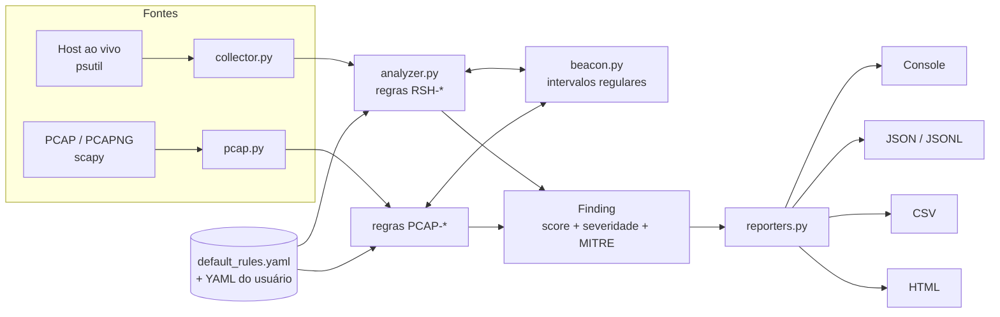

# Arquitetura

## Módulos

| Módulo | Responsabilidade |
|---|---|
| `collector.py` | Lista conexões TCP de saída (`ESTABLISHED`, `SYN_SENT`) e enriquece com processo, pai, usuário, caminho e linha de comando. |
| `analyzer.py` | Aplica as regras `RSH-*` a cada conexão e soma os pontos. Mantém estado entre varreduras para beaconing. |
| `beacon.py` | `detect_beacon()` (função pura) e `BeaconTracker` (estado). Regularidade medida pelo coeficiente de variação dos intervalos. |
| `pcap.py` | Reconstrói fluxos TCP de uma captura e aplica as regras `PCAP-*`. |
| `config.py` | Carrega e valida YAML, mescla configuração do usuário, allowlist e blocklist. |
| `catalog.py` | Catálogo `id -> (título, MITRE)`. Fonte única para `rules`, relatórios e docs. |
| `reporters.py` | Console, JSON, JSONL, CSV e HTML (valores sempre escapados). |
| `demo.py` | Cenários sintéticos para demonstração e testes manuais. |
| `cli.py` | `scan`, `pcap`, `demo`, `rules`. |

## Modelo de pontuação

Cada regra que dispara soma seu peso (configurável). A severidade é o maior limiar atingido:

| Score | Severidade |
|---|---|
| >= 7 | alto |
| >= 4 | médio |
| >= 1 | baixo |

Só achados com `score >= min_score` (padrão 3) são reportados. A ideia é **priorizar a fila de
triagem**, não emitir veredito: sinais fracos isolados (porta incomum = 1 ponto) não alertam sozinhos,
e a combinação de sinais (shell + pai suspeito + porta de payload) sobe rápido para "alto".

## Decisões de projeto

- **Só observa.** Nenhum pacote é enviado; nenhuma conexão é interrompida.
- **Sem dependência de rede.** Não consulta serviços de reputação; use `blocklist_file` com seus feeds.
- **Regras como dados.** Tudo que dá para ajustar (listas, pesos, limiares) está no YAML.
- **Funções puras onde possível** (`detect_beacon`, `Config.severity_for`) para facilitar testes.
